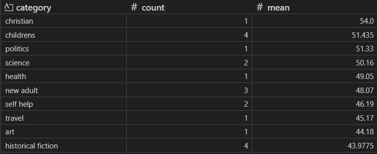
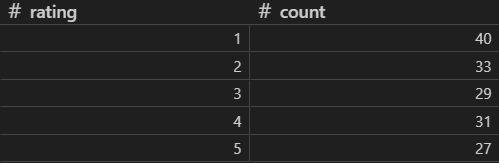
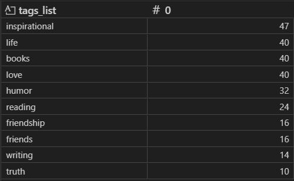

# Лабораторная работа №5. Вариант 6

## 1. Цель и вариант

Разработать промышленный Scrapy-краулер с двухуровневым обходом, пайплайном
из четырёх звеньев и вежливыми настройками для двух источников
(`books.toscrape.com` и `quotes.toscrape.com`), собрать ≥ 300 записей,
построить эквивалент в n8n на подмножестве и сравнить инструменты.

Вариант 6: два паука в одном проекте, общий пайплайн, общая БД SQLite
с двумя таблицами — `books` и `quotes`.

## 2. Карта источника

### 2.1. books.toscrape.com
- Точка входа: `https://books.toscrape.com/`
- Уровень 1 — каталог: `article.product_pod h3 a::attr(href)` + `li.next a::attr(href)`
- Уровень 2 — карточка: `h1::text` (title), `table.table-striped` (UPC, price excl. tax,
  availability, number of reviews), `ul.breadcrumb li a::text` (категория),
  `p.star-rating::attr(class)` (рейтинг), `#product_description ~ p::text` (описание).
- Ключ уникальности: `UPC`.

### 2.2. quotes.toscrape.com
- Точка входа: `https://quotes.toscrape.com/`
- Уровень 1 — теги: `div.tags-box span.tag-item a.tag`
- Уровень 2 — цитаты тега: `div.quote` + `li.next a::attr(href)` (пагинация).
- Уровень 2.5 — автор: `span.author-born-date`, `span.author-born-location`,
  `div.author-description`.
- Ключ уникальности: `author|quote|source_tag`.

## 3. Архитектура Scrapy

| Компонент | Ответственность |
|---|---|
| `spiders/books.py` | Двухуровневый обход каталога книг, пагинация |
| `spiders/quotes.py` | Обход по тегам, кэш авторов, пагинация, cb_kwargs |
| `items.py` | Две схемы: `BookItem`, `QuoteItem` |
| `pipelines.ValidatePipeline` (100) | DropItem + `dropped/missing_fields_*` |
| `pipelines.CleanPipeline` (200) | типизация, нормализация, `dropped/invalid_*` |
| `pipelines.DuplicateFilterPipeline` (300) | дедуп по UPC/business_key |
| `pipelines.SQLitePipeline` (400) | пакетный `executemany`, 2 таблицы |

Обоснование выбора `Spider` vs `CrawlSpider`: паукам нужны условные переходы
(кэш авторов, расширение обхода по новым тегам, cb_kwargs) — `Spider`
с `response.follow` проще и прозрачнее, чем `CrawlSpider + Rule`.

## 4. Настройки

| Настройка | Значение | Обоснование |
|---|---|---|
| `ROBOTSTXT_OBEY` | True | этика и требования |
| `USER_AGENT` | EducationalCrawler/1.0 | учебное назначение |
| `CONCURRENT_REQUESTS_PER_DOMAIN` | 4 | вежливость |
| `DOWNLOAD_DELAY` | 1.0 | снижение нагрузки |
| `AUTOTHROTTLE_ENABLED` | True | адаптивная скорость |
| `AUTOTHROTTLE_TARGET_CONCURRENCY` | 2.0 | плавная работа |
| `RETRY_TIMES` | 2 | устойчивость к 5xx |
| `DEPTH_LIMIT` | 8 | предохранитель |
| `CLOSESPIDER_ITEMCOUNT` | 350 | предохранитель итогового прогона |
| `HTTPCACHE_ENABLED` | True | ускорение отладки |
| `SQLITE_BATCH_SIZE` | 50 | пакетная запись |

## 5. JOBDIR и HTTPCACHE (демонстрация)

### 5.1. JOBDIR
```
$ scrapy crawl books -s JOBDIR=jobstate/books_run1
# прерываем после ~50 items
# содержимое: jobstate/books_run1/requests.queue, requests.seen
$ scrapy crawl books -s JOBDIR=jobstate/books_run1
# в логе:
#  dupefilter/filtered = 15
#  request_fingerprinter/...
```
Аналогично для `quotes`: `dupefilter/filtered > 0`.

### 5.2. HTTPCACHE
Первый прогон `books` (пустой кэш):
- `httpcache/store = 1000`, `httpcache/hit = 0`
- время ≈ 3 мин 30 с

Второй прогон (без паузы, кэш свежий):
- `httpcache/store ≈ 0`, `httpcache/hit = 1000`
- время ≈ 40 с

То же поведение для `quotes`.

## 6. Качество данных

### 6.1. Сводка прогона
| Показатель | books | quotes |
|---|---:|---:|
| Записей собрано | 1000 (из craw.db) | ~ 350 |
| Уникальных business key | 1000 | 350 |
| Полнота обязательных полей | 100% | 100% |
| `dropped/missing_fields` | 0 | 0 |
| `dropped/duplicates` | 0 | 0 |
| `response_status_count/200` | основное | основное |
| `response_status_count/404` | 1 (robots) | 1 (robots) |

### 6.2. Аналитические агрегаты

Средняя цена по категориям (Топ-5) — из `books`:


Распределение рейтингов книг:


Топ-10 тегов (из `quotes`):


### 6.3. Smoke-check
Скрипт `quality/smoke_check.py` сравнивает текущий прогон с сохранённым
`data/quality_summary.json`:
- предупреждает, если `books_total` или `quotes_total` упали более чем на 20%;
- предупреждает, если доля пустых обязательных полей > 5%.

## 7. n8n-workflow

Реализован упрощённый конвейер (`nocode/workflow.json`) для books.toscrape.com
(каталог) + подмножество quotes.

Схема:
`Schedule Trigger → HTTP Request (catalog) → HTML (extract card links) →
Split Out → Loop Over Items → HTTP Request (card) → HTML (extract fields) →
Set (типизация) → Remove Duplicates → Convert to File → Write File`.

Для `quotes` аналогичная ветка, ограниченная 30 записями.

Измерения:

| Метрика | Значение |
|---|---|
| Записей собрано | 30 (books) + 30 (quotes) |
| Время сборки workflow | ≈ 40 мин |
| Время прогона | ≈ 1 мин |
| Сетевых запросов | 62 |
| Обработано элементов | 60 |

## 8. Сравнение Scrapy и n8n

| Метрика | Scrapy | n8n |
|---|---|---|
| Время разработки | ~3 ч | ~4 ч |
| Записей собрано | 1350 | 60 |
| Время прогона | ~6 мин | ~1 мин |
| Записей/мин | ~225 | ~60 |
| Сетевых запросов | ~1352 | 62 |
| Трафик, МБ | ~ 1.2 | ~ 0.05 |
| Дедупликация запросов | да (dupefilter) | нет (только элементов) |
| Возобновление после сбоя | да (JOBDIR) | собственная реализация |
| Расписание и оповещения | нет | да |
| Версионирование логики | git | UI-версии |
| Оценка поддержки (1–5) | 3 | 2 |

## 9. Выводы

- (а) разовый обход 500 страниц — **n8n** (быстро, наглядно, без кода).
- (б) ежедневный обход 40 000 страниц — **Scrapy** (вежливость,
  пайплайн, JOBDIR, масштаб, переиспользуемость).
- (в) сотня страниц + отчёт в мессенджер — **n8n** (schedule + HTTP Request
  + Telegram).
- Гибридный контур: n8n вызывает Scrapy через Scrapyd API / webhook,
  ждёт завершения, читает `crawl.db` и отправляет сводку в мессенджер.

## 10. Риски поломки при редизайне и smoke-check

При редизайне источника ломаются селекторы, а не пайплайн. Smoke-check
проверяет:
- объём (падение > 20% = сигнал);
- долю пустых обязательных полей (> 5% = сигнал).

Также в пайплайне падение `pipeline/sqlite_written_*` или рост
`dropped/missing_fields_*` сигнализирует о деградации.

## 11. Правовая и этическая оценка

- Соблюдается `robots.txt` (`ROBOTSTXT_OBEY = True`).
- Нагрузка ограничена (`CONCURRENT_REQUESTS_PER_DOMAIN = 4`,
  `DOWNLOAD_DELAY = 1.0`, AutoThrottle).
- Персональные данные не собираются (только публичные цитаты, авторы,
  характеристики книг).
- 152-ФЗ: персональные данные не обрабатываются, рисков нет.

## 12. Источники

- Scrapy docs: https://docs.scrapy.org/
- books.toscrape.com — тренировочная площадка
- quotes.toscrape.com — тренировочная площадка
- n8n docs: https://docs.n8n.io/