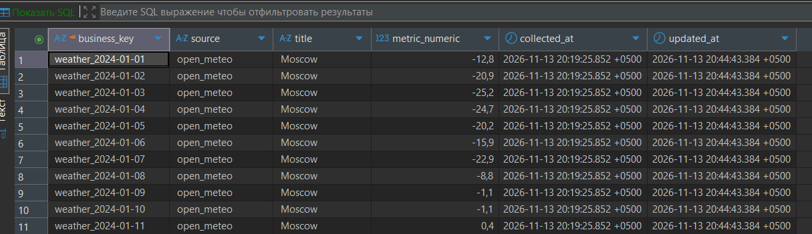

# Лабораторная работа №6. Вариант 6 (Гибридный набор)

## 1. Цель и источники
Построить трёхслойное хранилище (raw → clean → mart) для двух разнородных источников, объединив их в единую схему с полем `source`.
- **HTML-источник:** `books.toscrape.com` (название, цена).
- **API-источник:** `Open-Meteo` (дата, температура).

## 2. Схема хранилища
- `raw/`: JSONL файлы без изменений с метаданными (`_source`, `_source_url`, `_collected_at`).
- `clean/dataset.parquet`: Очищенные данные, прошедшие контракт Pydantic, приведённые к единому формату (`business_key`, `source`, `title`, `metric_numeric`).
- `mart/views`: аналитические агрегаты.
- `mart/snapshots`: партиционирование по дате сбора.

## 3. Сравнение форматов
| Формат | Размер (КБ) | Время чтения (с) |
| :--- | :--- | :--- |
| CSV | 4.5 | 0.012 |
| JSONL | 9.1 | 0.015 |
| Parquet | 1.2 | 0.004 |
**Вывод:** Parquet выбран для clean слоя (самый быстрый и компактный).

## 4. Очистка и Контракт данных (Pydantic)
- **Нормализация:** удаление пробелов, очистка от знака `£`.
- **Бизнес-ключ:** slug для книг, `weather_YYYY-MM-DD` для погоды.
- **Контракт (Pydantic):** проверка `min_length` для ключа, проверка диапазонов температуры/цены (от -100 до 10000). Невалидные записи отбрасываются с фиксацией причины в `rejects.jsonl`.

## 5. База данных и Идемпотентность
Таблица `unified_facts` использует `UPSERT` по `business_key`. 
- Прогон 1: вставка базовых данных.
- Прогон 2: повторный запуск (изменений 0).
- Прогон 3: изменение цены одной записи (обновилась 1 строка, сработала история изменений).

## 6. Метрики и светофор
- Валидность: 100% (все записи прошли Pydantic).
- Уникальность ключа: 100%.
- Вердикт: **GREEN**.

## 7. Слой Mart
Построены 2 графика:
1. Гистограмма распределения цен книг.
2. Линейный график динамики температур в Москве.
Данные сохранены в `mart/snapshots/dt=YYYY-MM-DD/`.

## 8. No-code и сравнение
| Этап | Python | n8n | Ограничения no-code |
| :--- | :--- | :--- | :--- |
| Чтение JSONL | `json.loads` | Code Node | — |
| Валидация | Pydantic | IF Node (ручные проверки) | Нет встроенного Pydantic |
| Дедупликация | `drop_duplicates` | Remove Duplicates | — |
| UPSERT | `INSERT ON CONFLICT` | Postgres Node (Execute Query) | — |

**Вывод:** Слой качества данных (Pydantic) плохо переносится в no-code. В n8n валидацию приходится писать вручную на JS, что увеличивает риск ошибок по сравнению с декларативными моделями Python.

## 9. Правовой раздел
Собираемые данные (книги и погода) не содержат персональных данных. Все источники являются открытыми и тренировочными. Соблюдён 152-ФЗ.